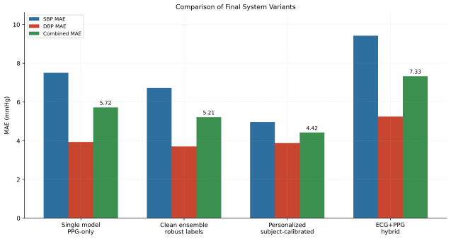
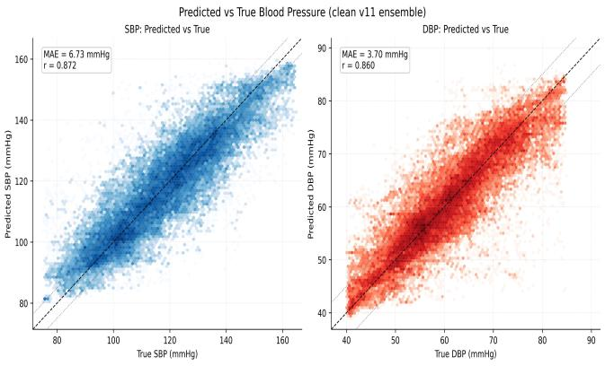
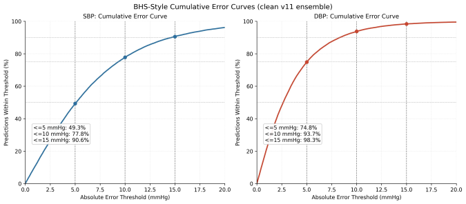
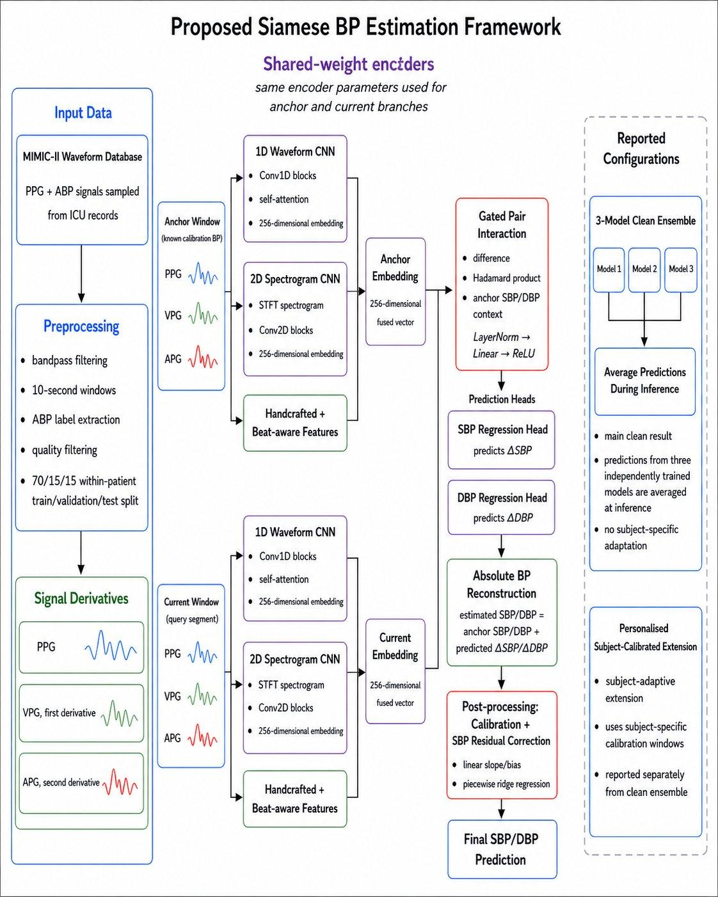

# Cuffless Blood Pressure Estimation from PPG

A Siamese neural network that estimates systolic and diastolic blood pressure (SBP/DBP) from a single photoplethysmography (PPG) signal, with no cuff. Built in PyTorch for my First Class final-year dissertation (BEng Biomedical and Healthcare Engineering, City St George's, University of London) and trained on the MIMIC-II ICU waveform database.

The model compares a patient-specific **anchor** PPG window (with known BP) against a **current** window and predicts the *change* in BP, which reduces the patient-to-patient variability that makes cuffless estimation hard. It extends the anchor-relative Siamese approach of Schlesinger et al. by replacing fixed subtraction fusion with learned, channel-wise gated pair interaction.

## Results

All results are on a held-out test set using a strict within-patient 70/15/15 split (661 patients, about 250k 10-second windows).

| System | SBP MAE (mmHg) | DBP MAE (mmHg) | Combined MAE (mmHg) | BHS grade (SBP/DBP) |
|---|---|---|---|---|
| Best single model (PPG-only) | 7.50 | 3.93 | 5.72 | C / A |
| **Clean 3-model ensemble** (main result, no per-subject data) | **6.73** | **3.70** | **5.21** | **C / A** |
| Personalised, subject-calibrated extension* | 4.96 | 3.88 | 4.42 | A / A |
| ECG+PPG hybrid (exploratory, negative result) | 9.42 | 5.24 | 7.33 | D / B |

\*The personalised result needs calibration windows from each subject, so it is **not directly comparable** to the ensemble. It shows what is achievable with per-subject calibration, and is reported separately.

Key points:
- DBP meets the AAMI-style criteria and BHS grade A in every PPG configuration.
- SBP stays at grade C without calibration. The error is concentrated at the tails of the MIMIC-II BP distribution (regression to the mean), not in systematic bias.
- Adding ECG as a fourth input channel did **not** help (combined MAE 7.33 mmHg vs 5.21 mmHg). This is reported as a negative result.

Combined MAE is `(SBP MAE + DBP MAE) / 2`. Accuracy is graded against the BHS standard and AAMI/ESH/ISO-style criteria.

<p align="center">
  
</p>

<p align="center">
  
  <br>
  <em>Predicted vs true SBP (left) and DBP (right), clean 3-model ensemble (SBP r = 0.872, DBP r = 0.860).</em>
</p>

<p align="center">
  
  <br>
  <em>BHS-style cumulative error curves, clean ensemble.</em>
</p>

## How it works

<p align="center">
  
</p>

- **Input:** 10-second PPG windows (resampled to 100 Hz, band-pass filtered 0.5-8 Hz) with first and second derivatives (VPG, APG) as extra channels.
- **Shared-weight encoders** (anchor and current branches): a 1D waveform CNN with temporal self-attention, a 2D STFT-spectrogram CNN, and handcrafted beat-aware features (heart rate, HRV, peak amplitude, pulse width and more).
- **Gated pair interaction:** the anchor and current embeddings are combined using their difference, Hadamard product, learned gating, and the anchor's BP as context. This is the main architectural change over fixed subtraction.
- **Prediction:** separate SBP and DBP heads predict the change from the anchor, and absolute BP is reconstructed as anchor BP plus predicted change.
- **Training:** AdamW, Huber loss with Pearson and CCC auxiliary terms, EMA weights, test-time augmentation.
- **Post-processing:** a validation-fitted linear calibration followed by a piecewise ridge correction for SBP residuals.
- **Evaluation:** MAE, RMSE, Pearson r, mean error, BHS grade, AAMI-style criteria.

Developed and trained with PyTorch on an NVIDIA RTX 2060.

## Important data note

The MIMIC-II waveform data are **not included** in this repository. Processed NumPy arrays, cached features, trained checkpoints and large output folders are not included either.

Access to MIMIC-II must be obtained separately through PhysioNet. After preprocessing, the training and evaluation scripts expect local dataset folders such as `C:\MIMIC2_out_v11`. This repository is for showing the code used in the project, not for distributing data, so the full pipeline can only be re-run by someone with PhysioNet access.

## Setup

```bash
git clone https://github.com/yahiabourennane-star/cuffless-bp-siamese-ppg.git
cd cuffless-bp-siamese-ppg
python -m venv .venv
# Windows: .venv\Scripts\activate     macOS/Linux: source .venv/bin/activate
pip install -r requirements.txt
```

A CUDA-capable GPU is strongly recommended for training. If you need a specific CUDA build of PyTorch, install it first using the selector at pytorch.org, then run `pip install -r requirements.txt`.

## Running the pipeline

The scripts were written and run on Windows, so the example commands below use Windows paths and the `^` line-continuation character. On macOS/Linux, replace `^` with `\` and change the paths.

**1. Preprocess MIMIC-II** (PPG-only dataset used for the final results):

```bash
python preprocess_mimic2_v4.py --input_dir "C:\MIMIC 2" --output_dir "C:\MIMIC2_out_v11"
```

**2. Train one model** (final-style settings):

```bash
python train.py ^
  --data_dir "C:\MIMIC2_out_v11" ^
  --save_dir ".\checkpoints_v11_abpbeat" ^
  --seed 42 ^
  --use_fusion ^
  --use_beat_features ^
  --use_gated_pair_interaction ^
  --no_mixup ^
  --no_balanced_sampling ^
  --sbp_loss_type huber ^
  --ccc_weight 0.06 ^
  --sbp_scale_weight 0.03 ^
  --epochs 150 ^
  --patience 30 ^
  --batch_size 256 ^
  --eval_batch_size 512 ^
  --lr 3e-4 ^
  --dropout 0.30 ^
  --embed_dim 256 ^
  --weight_decay 1e-3 ^
  --num_anchors 5 ^
  --target_scale 10.0 ^
  --quality_threshold 0.4 ^
  --preserve_ppg_amplitude ^
  --multi_anchor_eval ^
  --use_ema ^
  --ema_decay 0.999 ^
  --gap_penalty 0.15 ^
  --gap_target 1.0 ^
  --corr_weight 0.05 ^
  --sbp_weight 1.5 ^
  --tta 0 ^
  --workers 0
```

The exact commands used for individual experiments may differ slightly depending on the run folder.

**3. Train and evaluate the 3-seed ensemble** (the final clean result):

```bash
python run_ensemble.py --data_dir "C:\MIMIC2_out_v11" --n_seeds 3 --ensemble_dir ".\ensemble_v11_abpbeat"
```

**4. Evaluate a saved checkpoint:**

```bash
python evaluate.py --data_dir "C:\MIMIC2_out_v11" --checkpoint ".\checkpoints_v11_abpbeat\best_model.pt"
```

**5. Personalised subject-calibrated extension:**

```bash
python patient_specific_adapt.py --data_dir "C:\MIMIC2_out_v11" --ensemble_dir ".\ensemble_v11_abpbeat"
```

**6. Live visualisation dashboard:**

```bash
streamlit run app.py
```

The dashboard expects the processed dataset and a model checkpoint to exist locally. It shows predicted vs reference BP, error, running MAE, the PPG/VPG/APG waveforms, and a BP prediction-history plot.

Run any script with `--help` to see all options.

## Repository contents

| File | Purpose |
|---|---|
| `preprocess_mimic2_v4.py` | Builds the cleaned PPG-only dataset used for the final v11 experiments |
| `preprocess_mimic2_ecgppg.py` | Builds the ECG+PPG dataset for the exploratory hybrid experiment |
| `dataset.py` | Loads patient windows, anchor/current pairs, handcrafted and beat-aware features, spectrogram inputs |
| `siamese_cnn.py` | Siamese network architecture |
| `train.py` | Main training script (one model checkpoint) |
| `run_ensemble.py` | Trains and evaluates the multi-seed ensemble (final clean result) |
| `evaluate.py` | Evaluates saved checkpoints: MAE, RMSE, Pearson r, mean error, BHS grade |
| `metrics.py` | Metric helpers |
| `patient_specific_adapt.py` | Personalised subject-calibrated extension |
| `sweep_bhs_sbp_residual.py` | Tests SBP residual-correction settings |
| `plot_final_v11_dissertation_figures.py` | Generates the dissertation figures for the clean ensemble and personalised extension |
| `plot_training_history.py` | Training and validation curves from a saved history |
| `app.py` | Streamlit real-time visualisation demo |

### Why two preprocessing scripts?

`preprocess_mimic2_v4.py` is the final PPG-only pipeline behind the main v11 result. `preprocess_mimic2_ecgppg.py` is kept separate because the ECG+PPG experiment needed ECG as an extra channel and was evaluated as a different dataset variant, so the PPG result and the ECG+PPG negative result stay cleanly separated.

## Limitations

- Results are on MIMIC-II (ICU patients), a single dataset. Generalisation to other cohorts and to wearable PPG hasn't been tested, and clinical use would need independent validation.
- SBP accuracy is limited by the narrow distribution of the training data (little variation above or below the 100-130 mmHg range), which compresses predictions at the extremes.
- The personalised result depends on per-subject calibration data and shouldn't be compared directly with the ensemble.
- This is research code written for a dissertation, not a packaged library: some paths are hardcoded for Windows, and there is no automated test suite yet.

## Not included

- MIMIC-II waveform data
- processed `.npy` arrays, cached spectrograms and feature files
- trained model checkpoints
- large output folders and generated logs
- dissertation Word/PDF drafts

This keeps the repository small and avoids redistributing restricted data.

## Licence

MIT, see [LICENSE](LICENSE). The MIMIC-II dataset has its own access terms via PhysioNet.
